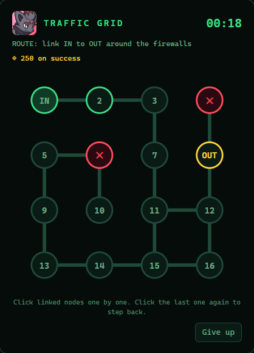

# GTA Local Online (Beta)

*Español: [README.es.md](README.es.md).*

**A private "GTA Online" for your local network**, built on GTA V Legacy's story mode. It is made of:
- a server of your own on Windows;
- a `.asi` client on every PC that plays;
- the **Gori Online** mod, with the content: freemode character, money, properties, businesses (salvage yards, bail
  offices, the garment factory and the Money Fronts too), heists, Transform races, deathmatch, Survival, contact
  missions, Drug Wars, Los Santos Customs and Benny's as in Online, Arena War with its workshop, Ammu-Nation, the
  Online phone...

No Rockstar servers, no Internet and no third-party accounts: everything lives on your LAN.

> ⚠️ This is not GTA Online and never connects to it.
> - You need your own legal copy of **GTA V Legacy** (Steam, Rockstar or Epic). This repository contains no game
>   files.
> - Use it in story mode only: ScriptHookV already refuses to load mods in GTA Online.

**➡️ Step-by-step guide from scratch: [docs/INSTALL.md](docs/INSTALL.md)** (Spanish:
[docs/GUIA-INSTALACION.md](docs/GUIA-INSTALACION.md))

---

## How it works

```
 Server PC (Windows)                           PCs that play (Windows, or Linux with Proton)
 ┌──────────────────────────┐   LAN, UDP 4499  ┌─────────────────────────────────────────┐
 │ LocalOnlineServer.exe    │ ◄──────────────► │ GTA V Legacy 1.0.3889 + ScriptHookV      │
 │  · accounts, characters  │      (ENet)      │  · LocalOnline.asi  (network, YOU        │
 │  · money (a ledger)      │                  │    character, other players, money,      │
 │  · jobs and races        │                  │    garage)                               │
 │  · shared time, weather  │                  │  · GoriOnline.asi   (Online's content:   │
 │  · SQLite (data/*.db)    │                  │    menus, missions, businesses...)       │
 └──────────────────────────┘                  └─────────────────────────────────────────┘
```

- The **server** doesn't need GTA. It runs on any Windows PC on the network, including one of those that play.
- Everyone sees the others, their cars and their clothes. The server keeps the money, the profiles and the job
  payouts.
- Up to 8 players (configurable).

## What's included

| Part | What it does |
|---|---|
| `LocalOnline.asi` | *Story Mode / Local Online* start screen, freemode character creator, player and vehicle sync, server-checked PvP, Maze Bank, the Online HUD, garage, co-op jobs. Menu: **F10**. |
| `GoriOnline.asi` | Online's interaction menu (**M**, or hold *Back/Select* on a controller): properties and businesses, heists, contact missions, races (and a race creator), deathmatch, Survival, The First Dose / The Last Dose and the Acid Lab, LS Customs, Ammu-Nation, special vehicles, yacht, casino, the Online Internet and phone. |
| `LocalOnlineServer.exe` | The authoritative server: accounts, characters, an economy with anti-cheat limits, jobs, races, deathmatch, Survival, shared time and weather. |
| `netprobe.exe` | A test client without GTA, to check that the network reaches the server. |
| `godeye/` | **GodEye**, the web app for watching and playing from a browser (below). |

**Known limits:**
- NPCs aren't synced between players: in Survival and in missions everyone fights their own enemies, at the same
  time and in the same place.
- It only works with GTA V Legacy **1.0.3889**, not with GTA V Enhanced.
- Online's jobs are recreations, not Rockstar's originals.

## GodEye: the session seen (and played) from a browser



**GodEye** is a web app on the server PC, next to `LocalOnlineServer.exe`. With it you watch the session live, and
you play against the people in GTA without GTA:

- **Live map:** players, cars, speed, health, wanted stars and zone.
  - A 2D map.
  - The real 3D map, built on your PC from *your* game files, with Cayo Perico and our own islands. It follows the
    session's clock, weather and blackouts.
- **Cameras:** a second GTA on the server PC acts as a camera.
  - CCTV, follow, helicopter, drone, cinematic…
  - Live video: WebRTC on the LAN, HLS from the internet.
- **An asymmetric game by roles:**
  - HACKER: traffic lights and blackouts.
  - DISPATCH: wanted stars, police alerts and roadblocks.
  - OPERATOR: weather, time, cameras and events.
- **Hack Credits:**
  - Actions cost credits, earned by watching, with a daily bonus and with bounties.
  - The big hacks first need a **hacking minigame**, checked by the server.
  - Daily limits, cooldowns, and events: electrical storm, gridlock, manhunt, happy hour.
- **Accounts and a control panel:**
  - Everyone makes their own account, in the browser or in the GodEye app, and picks a side.
  - The first account on a fresh install is the **ADMIN**, the server's owner. The ADMIN's **control panel** shows
    the PC (CPU, memory, graphics cards, disks), the game server, GodEye, accounts and roles, settings, credits and
    logs.
- **Security:**
  - Logins with roles, CSRF and per-user limits.
  - Every action is logged.
  - The browser never talks to GTA: everything goes through the server.
- **`GodEye.exe`:** opens and closes it from the desktop, on the graphics card you choose.
- **Remote access (optional):** a public address through Cloudflare Tunnel.
- **Mascot:** Zorua, as community sprites (credits below).

Setting it up: [godeye/README.md](godeye/README.md) · design: [docs/godeye.md](docs/godeye.md).

<br clear="right">

## Quick start

1. Download the latest [release](../../releases): `GTALocalOnline-Server-*.zip` and `GTALocalOnline-Client-*.zip`.
2. **Server (one Windows PC):**
   - unzip it, and copy `server.example.toml` to `server.toml`;
   - open the firewall with `setup-firewall.ps1`;
   - run `start-server.bat`, and note its IP (`ipconfig`).
3. **Every PC that plays:**
   - install [ScriptHookV](http://www.dev-c.com/gtav/scripthookv/) for version 3889;
   - copy `LocalOnline.asi`, `GoriOnline.asi` and the `LocalOnline\` folder into the GTA V folder;
   - put the server's IP and your name in `LocalOnline\client.toml`.
4. On Linux / Steam Deck, add these launch options in Steam:
   `WINEDLLOVERRIDES="dinput8,xinput1_4=n,b" %command%`.
5. Start GTA V and pick **LOCAL ONLINE** on the start screen.

Every detail, what to expect and troubleshooting: **[docs/INSTALL.md](docs/INSTALL.md)**.

## Building from source

You need Windows with:
- [w64devkit](https://github.com/skeeto/w64devkit) (MinGW g++ 14 or newer);
- Python 3;
- Git Bash (or w64devkit's own shell).

```bash
export W64DEVKIT=/c/path/to/w64devkit/bin   # or put its bin/ on the PATH
./build.sh          # tests + LocalOnline.asi + LocalOnlineServer.exe + netprobe.exe
./build.sh gori     # GoriOnline.asi
./build.sh godeye   # GodEye.exe
```

The binaries end up in `build/`. Neither Visual Studio nor the ScriptHookV SDK is needed: the `.asi` files link
ScriptHookV at run time with `GetProcAddress`.

## Layout

```
client/gta-plugin/   LocalOnline.asi (C++20)
client/linux/        deploy.sh: copies the client to a Linux PC over SSH
gori-online/         GoriOnline.asi (C++20) and its data generators (tools/)
server/              LocalOnlineServer.exe, the SQLite schema and Windows scripts
shared/              the network protocol and code shared by client and server
config/              server.example.toml and client.example.toml
tests/               unit tests (they run on every ./build.sh)
tools/netprobe/      the network test client
godeye/              GodEye: backend (Node.js), web app, GodEye.exe launcher, Cloudflare Worker, Zorua sprites
tools/godeye-map/    makes GodEye's 2D/3D maps from your game files (never published)
docs/                the installation guide and the technical docs
third_party/         ENet and SQLite (see THIRD_PARTY.md)
```

Technical docs: [architecture](docs/architecture.md), [protocol](docs/protocol.md), [decisions](docs/decisions.md),
[multiplayer and content](docs/multiplayer.md), [Proton](docs/proton.md), [known problems](docs/troubleshooting.md).

## License

[MIT](LICENSE). ENet (MIT), SQLite (public domain) and three.js (MIT) keep their own licenses: see
[THIRD_PARTY.md](THIRD_PARTY.md).

GodEye's Zorua sprites in `godeye/` are community sprites from
[PMDCollab SpriteCollab](https://github.com/PMDCollab/SpriteCollab), by **baronessfaron**, **Emmuffin** and
**MilesFarber**.
- Their license is [CC BY-NC 4.0](https://creativecommons.org/licenses/by-nc/4.0/): non-commercial use, crediting the
  authors.
- Zorua is © Nintendo / Creatures / GAME FREAK, and GodEye is a non-commercial fan project.

GTA V and its trademarks belong to Rockstar Games / Take-Two; this project is not affiliated with them.
